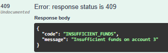

## BUG-001: `AccountService.withdraw` отклоняет снятие суммы, равной балансу, с 409 INSUFFICIENT_FUNDS

| Поле                | Значение                                                      |
|---------------------|---------------------------------------------------------------|
| Обнаружен при       | Ручная проверка по `docs/checklist.md` (границы суммы снятия) |
| Связанный тест-кейс | TC-API-022                                                    |
| Компонент           | `POST /api/accounts/{id}/withdraw`                            |
| Окружение           | Java 17.0.12, сервис версии/коммита `77f99ec8`                |
| Серьёзность         | Major                                                         |
| Приоритет           | Medium                                                        |
| Статус              | Open                                                          |

**Предусловия:** нет

**Шаги воспроизведения:**
1. Создать счёт: `POST /api/accounts` `{"owner": "Alice", "balance": 150}` и запомнить {id} из ответа.
2. Выполнить `POST /api/accounts/{id}/withdraw` `{"amount": 150}`.
3. Проверить баланс в БД: `SELECT balance FROM accounts WHERE id = {id};`

**Фактический результат:** 409 INSUFFICIENT_FUNDS`, баланс в БД не изменился (150.00)

**Ожидаемый результат:** `200`, баланс `0` (REQ-4: сумму, равную балансу, снять можно).

**Последствия:** клиент не может снять весь остаток одной операцией; обходной путь: снять на копейку меньше.

**Причина:** в проверке остатка использовано нестрогое сравнение (`>=`), поэтому равенство суммы и баланса считается нехваткой средств.

**Доказательство:**
{"code": "INSUFFICIENT_FUNDS","message": "Insufficient funds on account 3"}

